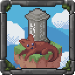
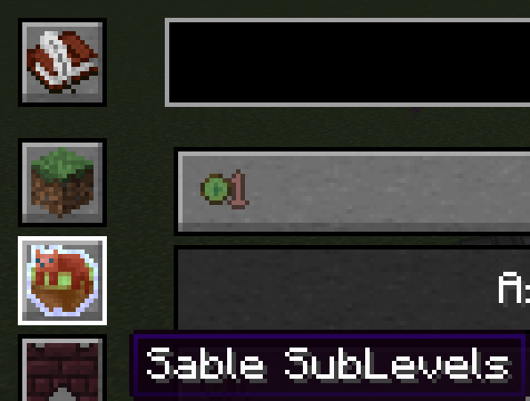

  

<h1 align="center">WaystonesSable</h1>

  
  
  

  <a href="https://modrinth.com/mod/waystones-sable">Modrinth</a> ·
  <a href="https://www.curseforge.com/minecraft/mc-mods/waystones-sable">CurseForge</a> ·
  <a href="https://github.com/SShakusora/WaystonesSable/issues">Report an issue</a>

WaystonesSable connects [Waystones](https://www.curseforge.com/minecraft/mc-mods/waystones) with
[Sable](https://www.curseforge.com/minecraft/mc-mods/sable), so you can travel between waystones on the ground and
those aboard moving structures. It handles teleport destinations, distance calculations, and waystone
relocation during assembly and disassembly.

Sable calls these moving structures **SubLevels**: collections of blocks and entities with their own
position and orientation in the world. WaystonesSable accounts for that movement when you select and
travel to a destination.

> [!WARNING]
> WaystonesSable uses Mixins to modify vanilla Minecraft and Sable, which may cause unexpected
> behavior during gameplay. If you encounter any problems, please
> [submit an issue](https://github.com/SShakusora/WaystonesSable/issues).

## Features

- **Travel to moving structures.** Transform teleport destinations and arrival directions to account
  for a SubLevel's position and rotation.
- **Return to unloaded structures.** Restore stored SubLevels during teleport preparation when their
  saved association and destination can be validated.
- **Keep waystones through assembly and disassembly.** Preserve their identities and update their
  locations as blocks move. Assembly includes both halves of a waystone and rejects incomplete pairs.
- **Use world distances.** Account for a structure's world position in selection-menu coordinates and
  distance-based teleport requirements.
- **Find structure destinations together.** Automatically include waystones aboard SubLevels in the
  **Sable SubLevels** group in the destination menu.
- **Arrive with synchronized movement.** Clear motion inherited from the previous structure and
  synchronize arrival state between the server and clients.

Additional handling covers Return Scroll destination selection, Twinbound Feather player targets,
and Warp Plate arrival coordinates. Return Scrolls prefer an active return portal, then select the
nearest valid activated waystone in the same dimension whose world position can be determined.
Twinbound Feather targets are rechecked during preparation, including whether the linked player is
still available and carrying a paired feather.

### SubLevel grouping

Waystones aboard Sable SubLevels are automatically added to the **Sable SubLevels** group.
Use the sidebar icon to find destinations on moving structures.

  

## FAQ

**Do I need Create or Create Aeronautics?**

Both are optional for WaystonesSable. Create enables additional assembly integration; Create Aeronautics requires Create and adds its own gameplay.

## Reporting issues

Open a [GitHub issue](https://github.com/SShakusora/WaystonesSable/issues) with:

- Your Minecraft, NeoForge, WaystonesSable, Waystones, Sable, and relevant addon versions.
- Whether the problem occurs in singleplayer or on a dedicated server.
- Steps to reproduce, expected behavior, and what actually happened.
- Whether the structure was moving, unloaded, assembled, or disassembled before the problem occurred.
- The relevant `logs/latest.log`, a crash report if available, and screenshots or a short recording
  when they help show the problem.
